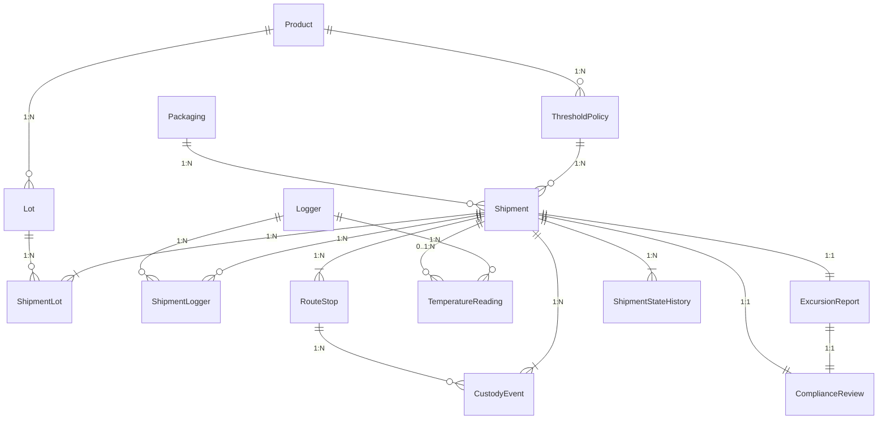

# ColdChain Compliance — Shipment Monitoring & Deviation Management

[](https://www.python.org/)
[-brightgreen.svg)](#1-quick-start--make-it-run)
[](#6-reproducibility--validation-proof-steps-8--10)
[-success.svg)](docs/VALIDATION_SUMMARY.md)

**End-to-End Solution for Temperature-Sensitive Pharmaceutical & Biologic Shipment Compliance, Excursion Evaluation, Operational QA Audit, Traceability, and Deviation Management.**

---

## Table of Contents
1. [Quick Start — Make It Run](#1-quick-start--make-it-run)
2. [Problem Statement, Actors & Business Workflow](#2-problem-statement-actors--business-workflow)
3. [Relational Schema, Nomenclature & Bridge Tables](#3-relational-schema-nomenclature--bridge-tables)
4. [Thermodynamic & Compliance Decision Engine (Why & How)](#4-thermodynamic--compliance-decision-engine-why--how)
5. [Controlled Negative Edge Cases, Operational QA Audit & Ground-Truth Isolation](#5-controlled-negative-edge-cases-operational-qa-audit--ground-truth-isolation)
6. [Reproducibility & Validation Proof (Steps 8 & 10)](#6-reproducibility--validation-proof-steps-8--10)
7. [Design Decisions, Assumptions, Trade-offs & Limitations](#7-design-decisions-assumptions-trade-offs--limitations)
8. [Public Data Guidance & Lawful Provenance](#8-public-data-guidance--lawful-provenance)
9. [Repository Structure](#9-repository-structure)

---

## 1. Quick Start — Make It Run

This project uses **100% Python Standard Library (`csv`, `json`, `sqlite3`, `math`, `hashlib`, `datetime`, `unittest`)** with **zero external third-party package dependencies** so any reviewer can clone and run it immediately on Windows, macOS, or Linux.

### Prerequisites
- Python `3.10+` (verified on Python `3.13.5` and `3.14.5` across Linux and Windows environments)

### Step 1: Run the End-to-End Pipeline (Generates Starter & Full Datasets + Runs All Validations)
```bash
python -m src.cli --seed 20261022
```
What this single command does in ~20 seconds:
1. Generates the **Starter Dataset** (`250` shipments, `100` loggers, `4,666` 10-minute readings) in `data/starter/` (`CSV`, `JSON`, `SQLite DB`, `SQL seed`, `ground_truth`, and `source_manifest.json`).
2. Generates the **Full Baseline Dataset** (`5,000` shipments, `1,000` loggers, `93,395` 10-minute readings, `190,985` total records across `14` operational/review tables + separate `GroundTruth`) in `data/full/`.
3. Executes the **Step 8 Validation Suite** (`329,900` foreign-key and compound integrity checks, primary-key regex checks, logger calibration/non-overlap checks, lot usability checks, arithmetic reconciliations, complete lifecycle DAG checks, manifest SHA-256 checksum checks, and independent operational anomaly audits).
4. Executes the **Step 10 Reproducibility Proof** (regenerates twice with `--seed 20261022` and compares row counts and SHA-256 checksums across all `31` manifest-listed CSV, JSON, SQL, and Ground-Truth files, plus verifies SQLite `PRAGMA foreign_keys = ON` enforcement on `cold_chain_compliance.db`).
5. Writes [`docs/VALIDATION_SUMMARY.md`](docs/VALIDATION_SUMMARY.md) and [`docs/VALIDATION_REPORT.json`](docs/VALIDATION_REPORT.json), exiting non-zero (`sys.exit(1)`) if any validation or reproducibility check fails.

### Step 2: Run the Automated Unit & Human-QA Regression Test Suite (`21` Tests)
```bash
python -m unittest discover -s tests -v
```

### Step 3: Run Individual Generator, Validator, or Shipment Inspector CLI Commands
```bash
# Generate only the starter dataset (250 shipments, 100 loggers)
python -m src.generator --seed 20261022 --scale starter --output-dir data/starter

# Generate the full 5,000-shipment, 1,000-logger dataset
python -m src.generator --seed 20261022 --scale full --output-dir data/full

# Run the standalone validator & two-run reproducibility verifier (in-memory or on exported files)
python -m src.validator --seed 20261022 --scale full --report-out docs/VALIDATION_REPORT.json
python -m src.validator --input-dir data/starter --scale starter

# View the Operations Manager & Analyst portfolio summary and exception queue (zero GroundTruth usage)
python -m src.inspector --scale starter --list-exceptions
python -m src.inspector --input-dir data/starter --list-exceptions

# Inspect a complete traceability dossier for any individual shipment (e.g. an injected anomaly)
python -m src.inspector --scale starter --shipment-id SHP-2026-000018
```

---

## 2. Problem Statement, Actors & Business Workflow

### Business Objective
Prove that temperature-sensitive shipments (biologics, mRNA vaccines, monoclonal antibodies, insulin peptides, blood plasma) remained within product and route requirements from pack-out through final receipt, and manage deviations with full audit traceability.

### Primary Actors & Responsibilities
| Actor Role | System Responsibility & Decisions Recorded |
| :--- | :--- |
| **`SUPPLIER`** | Manufactures `Product` lots (`Lot`), verifies thermal `Packaging` qualification at pack-out (`PACKOUT_SEALED`), and transitions shipment from `PLANNED -> PACKED`. |
| **`PLANNER`** | Schedules `Shipment` routes (`RouteStop`), assigns product `ThresholdPolicy`, and binds calibrated `Logger` units via `ShipmentLogger`. |
| **`CARRIER_OPERATOR`** | Executes physical pickup (`CARRIER_PICKUP`), air/road/multimodal transit, and hub transfers (`IN_TRANSIT`). |
| **`WAREHOUSE_OPERATOR`** | Logs transit hub arrivals (`HUB_ARRIVAL_SCAN`), cold-room storage or tarmac dwell events, and destination receipt (`FINAL_RECEIPT`, `DELIVERED`). |
| **`LOGISTICS_ANALYST`** | Evaluates 10-minute `TemperatureReading` telemetry, flags missing-data or custody gaps, dispositions minor excursions (`RELEASE_WITH_STABILITY_DEDUCTION`, `QA_MANUAL_REVIEW`), and logs `ComplianceReview` records for compliant shipments. |
| **`OPERATIONS_MANAGER`** | Performs independent QA audits (`ComplianceReview`), overrides defective pre-audit `ExcursionReport` dispositions (`OVERRIDDEN_CORRECTED`), appends corrective `ShipmentStateHistory` transitions (`AUDIT_OVERRIDE_*`), and issues final `QUARANTINE_HOLD` or `REJECT_DESTROY` decisions (`CLOSED_QUARANTINED`, `CLOSED_REJECTED`). |

---

## 3. Relational Schema, Nomenclature & Bridge Tables

Full field-level rules, data types, units, enums, and constraints are documented in [`docs/DATA_DICTIONARY.md`](docs/DATA_DICTIONARY.md).



### Strict Deterministic ID Nomenclature (Step 3)
| Entity | Nomenclature Pattern | Example ID | Full Scale Rows | Starter Scale Rows |
| :--- | :--- | :--- | ---: | ---: |
| `Product` | `PROD-2026-<0001..0010>` | `PROD-2026-0001` | `10` | `10` |
| `ThresholdPolicy` | `POL-2026-<0001..0010>` | `POL-2026-0001` | `10` | `10` |
| `Packaging` | `PKG-2026-<0001..0010>` | `PKG-2026-0001` | `10` | `10` |
| `Lot` | `LOT-2026-<6-digit>` | `LOT-2026-000001` | `400` | `50` |
| `Logger` | `LOG-<shipment-id>-01` | `LOG-SHP-2026-000001-01` | `1,000` | `100` |
| `Shipment` | `SHP-2026-<6-digit>` | `SHP-2026-000001` | `5,000` | `250` |
| `ShipmentLot` *(Bridge)* | `SHPLOT-2026-<6-digit>` | `SHPLOT-2026-000001` | `6,000` | `300` |
| `ShipmentLogger` *(Bridge)* | `ASSGN-2026-<6-digit>` | `ASSGN-2026-000001` | `4,950` | `247` |
| `RouteStop` | `STOP-<shipment-id>-<01..03>` | `STOP-SHP-2026-000001-01` | `15,000` | `750` |
| `CustodyEvent` | `CUST-2026-<7-digit>` | `CUST-2026-0000001` | `15,000` | `750` |
| `TemperatureReading` | `TEMP-<logger-id>-<YYYYMMDDHHMMSS>` | `TEMP-LOG-SHP-2026-000001-01-20260102060000` | `93,395` | `4,666` |
| `ExcursionReport` | `EXCR-2026-<6-digit>` | `EXCR-2026-000001` | `5,000` | `250` |
| `ComplianceReview` | `REV-2026-<6-digit>` | `REV-2026-000001` | `5,000` | `250` |
| `ShipmentStateHistory` | `STHIST-2026-<7-digit>` | `STHIST-2026-0000001` | `30,200` | `1,509` |
| `GroundTruth` *(Separate)* | Keyed by `shipment_id` | `SHP-2026-000001` | `5,000` | `250` |

---

## 4. Thermodynamic & Compliance Decision Engine (Why & How)

All metrics in `ExcursionReport` and `ComplianceReview` are derived directly from source `TemperatureReading`, `CustodyEvent`, and `ThresholdPolicy` records in [`src/compliance_engine.py`](src/compliance_engine.py):

1. **Mean Kinetic Temperature (MKT) via Haynes Formula (inspired by USP \<1079\> guidance)**:
   $$\text{MKT (K)} = \frac{\Delta H / R}{-\ln \left( \frac{1}{N} \sum_{i=1}^{N} e^{-\Delta H / (R \cdot T_i)} \right)}$$
   where $\Delta H = 83.14472\text{ kJ/mol}$ and $R = 0.008314472\text{ kJ/(mol}\cdot\text{K)}$. Because MKT weights higher temperatures exponentially, brief thermal spikes have a higher kinetic impact than arithmetic averages reveal. Non-finite (`NaN`/`Inf`) temperatures or uncertainties are immediately rejected.
2. **Bounded Excursion Duration & Contiguous Window Calculation**:
   - Readings within the inclusive range `[min_temp_c, max_temp_c]` are compliant; readings strictly outside (`< min_temp_c` or `> max_temp_c`) are breaches.
   - Excursion duration uses a **piecewise-constant forward hold** on disjoint intervals $[t_i, t_{\text{next}})$ clipped to $[\text{actual\_departure\_utc}, \text{actual\_arrival\_utc}]$, where $t_{\text{next}} = t_{i+1}$ for interior readings and $t_{\text{next}} = t_{\text{arr}}$ for the final reading. This guarantees `total_excursion_duration_min` and `max_single_excursion_min` are strictly bounded by `[0, trip_minutes]` (e.g., a 10-minute trip with readings at `0` and `10` both at `9°C` has `10` excursion minutes, not `20`; a 0-minute trip has `0` excursion minutes).
   - If a breach occurs only at the final arrival timestamp (`interval_min == 0`) or spans across an irregular telemetry gap ($\Delta t > 10\text{ min}$), `uncertainty_borderline_flag = True` prevents automatic release and routes the shipment to `INVESTIGATION_REQUIRED` / `QA_MANUAL_REVIEW` or `NON_COMPLIANT_MISSING_DATA` / `QUARANTINE_HOLD`.
3. **Calibration Uncertainty Borderline Rule**:
   - Every logger carries a synthetic `calibration_uncertainty_c` ($\pm 0.15^\circ\text{C}$ to $\pm 0.50^\circ\text{C}$). When a reading lies within $0 < |T - T_{\text{limit}}| \le \text{uncertainty}$, `uncertainty_borderline_flag` is set to `True` and routed to `INVESTIGATION_REQUIRED` / `QA_MANUAL_REVIEW`.
4. **Strict 10-Minute Time-Grid Telemetry, Duplicate Detection & Custody Gap Rules**:
   - Expected readings are verified against the explicit 10-minute timestamp grid $\{t_{\text{dep}}, t_{\text{dep}}+10\text{m}, \dots, t_{\text{arr}}\}$ rather than raw row counts.
   - Any missing expected grid point (`missing_reading_count > 0`), off-grid reading timestamp, duplicate reading ID/timestamp, or gap $\ge \text{max\_telemetry\_gap\_min}$ sets `telemetry_gap_flagged = True` (`NON_COMPLIANT_MISSING_DATA`) and prevents `COMPLIANT` release.
   - Every `CustodyEvent` records both `handoff_started_utc` and `event_timestamp_utc`, and `handover_gap_min` is derived directly from `(event_timestamp_utc - handoff_started_utc)`. Any delay $> \text{max\_custody\_gap\_min}$ (default `120` min) sets `custody_gap_flagged = True` (`NON_COMPLIANT_CUSTODY_GAP`).
5. **Product-Policy Compatibility, Effective-Date Selection & Cross-Shipment Isolation**:
   - `select_effective_policy_for_product()` selects the canonical `ThresholdPolicy` whose `[effective_from, effective_to]` window covers the shipment's departure and arrival.
   - `ComplianceEngine.evaluate_shipment()` verifies `policy.product_id == expected_product_id`, policy effective dates, and that readings belong strictly to `expected_shipment_id` and `expected_logger_ids` within `[actual_departure_utc, actual_arrival_utc]`.

---

## 5. Controlled Negative Edge Cases, Operational QA Audit & Ground-Truth Isolation

In accordance with **Step 4**, **Step 5**, and **Step 7**:
- Product assignment is stratified across 100-shipment scenario blocks so **all `10` products experience all `11` scenario categories (`110 / 110` product-scenario combinations covered)** in the 5,000-shipment dataset.
- Valid baseline records are generated first, and **5 specific negative system/process edge cases** (`50` shipments each in full scale, `250` total; `96.0%` pre-audit report decision accuracy) are injected into `ExcursionReport`.
- Operational QA auditing (`ComplianceEngine.audit_shipment_record` / `ComplianceEngine.audit_dataset`) runs **exclusively on operational master/transaction/event tables and `ExcursionReport` (never reading `GroundTruth`)**, persists its findings in `ComplianceReview` (`REV-2026-000001` .. `005000`), and appends a corrective `seq 7` lifecycle event (`AUDIT_OVERRIDE_*`) to `ShipmentStateHistory` whenever an override changes the shipment's final disposition state (`100.0%` post-audit accuracy):

| Edge Case Label (`anomaly_type`) | Count (Full) | How It Manifests in Pre-Audit Input Data | How the Operational Auditor Detects & Resolves It (`ComplianceReview`) |
| :--- | ---: | :--- | :--- |
| `LOGGER_NOT_ASSIGNED` | `50` | No row in `ShipmentLogger` for the shipment; logger records 3 orphan readings with `shipment_id = NULL`; `ExcursionReport.logger_id_evaluated = NULL`. | Joins `Shipment` to `ShipmentLogger`, flags `LOGGER_NOT_ASSIGNED` in `ComplianceReview`, and holds shipment in `CLOSED_QUARANTINED`. |
| `PRODUCT_THRESHOLD_MISMATCH` | `50` | `Shipment.assigned_policy_id` points to a policy belonging to a different product temperature regime than `Shipment.primary_product_id`. | Selects canonical policy via `select_effective_policy_for_product()`, recomputes status, and records `OVERRIDDEN_CORRECTED` (+ `seq 7` state transition when disposition changes). |
| `MISSING_DATA_SILENTLY_PASSED` | `50` | 5 consecutive 10-minute readings are dropped (`50-min` gap $>$ policy limit), but `ExcursionReport` leaves `telemetry_gap_flagged = False` and marks `COMPLIANT` / `AUTO_RELEASE`. | Recomputes 10-minute grid coverage, overrides disposition to `QUARANTINE_HOLD`, and appends `seq 7` (`CLOSED_RELEASED -> CLOSED_QUARANTINED`) to `ShipmentStateHistory`. |
| `CUSTODY_GAP_NOT_FLAGGED` | `50` | Transit hub `CustodyEvent` has `165`-min `(event_timestamp_utc - handoff_started_utc)` delay ($> 120$ min limit), but `custody_gap_flagged = False` and `ExcursionReport` marks `COMPLIANT`. | Recomputes custody gap from timestamps, overrides disposition to `QUARANTINE_HOLD`, and appends `seq 7` (`CLOSED_RELEASED -> CLOSED_QUARANTINED`) to `ShipmentStateHistory`. |
| `CROSS_SHIPMENT_EXCURSION_CALC` | `50` | `ExcursionReport.total_excursion_duration_min` includes excursion minutes from a prior shipment on the same `logger_id`, falsely triggering `REJECT_DESTROY`. | Recomputes single-shipment excursion duration (`10` min minor excursion), overrides disposition to `RELEASE_WITH_STABILITY_DEDUCTION`, and appends `seq 7` (`CLOSED_REJECTED -> CLOSED_RELEASED`). |

---

## 6. Reproducibility & Validation Proof (Steps 8 & 10)

Full validation results are available in [`docs/VALIDATION_SUMMARY.md`](docs/VALIDATION_SUMMARY.md) and [`docs/VALIDATION_REPORT.json`](docs/VALIDATION_REPORT.json).

- **Primary Key & Nomenclature Regex**: `100% PASS` (`0` errors across all `14` operational/review tables / `185,985` rows).
- **Foreign Key & Compound Join Integrity**: `100% PASS` (`329,900` foreign-key references verified + compound `ShipmentLot` product match, `CustodyEvent` stop-shipment match, and `ExcursionReport.first_breach_reading_id` shipment/logger match).
- **Date, Calibration Window, Non-Overlap & Lot Usability Checks**: `100% PASS` (verifies `Logger` calibration window covers every assigned shipment, zero overlapping `ShipmentLogger` windows per logger, and `Lot` usability/release state at dispatch).
- **Arithmetic & Complete Lifecycle Reconciliation**: `100% PASS` (`5,000` shipment declared values reconciled to `SUM(lot_qty * unit_value_usd)`, `15,000` route stop dwells and `15,000` custody handoff gaps reconciled from timestamps, and `5,000` complete `ShipmentStateHistory` chains reconciled with final `Shipment.lifecycle_state` and `ComplianceReview`).
- **Operational Audit vs. Ground Truth**: `5,000 / 5,000` (`100.0%`) exact match (`96.0%` pre-audit `ExcursionReport` decision accuracy before override -> `100.0%` post-audit `ComplianceReview` accuracy).
- **Step 10 Fixed-Seed Reproducibility**: Regenerating twice with `--seed 20261022` produces **100% identical row counts and SHA-256 checksums** across all `31` manifest-listed CSV, JSON, SQL, and Ground-Truth files, plus verifies `PRAGMA foreign_keys = ON` enforcement on `cold_chain_compliance.db`.

---

## 7. Design Decisions, Assumptions, Trade-offs & Limitations

### Key Design Choices & Assumptions
1. **Logger Reuse Across Non-Overlapping Waves (`5,000` Shipments / `1,000` Loggers)**:
   - To satisfy both `5,000 shipments, 1,000 loggers` and the ID convention `LOG-<shipment-id>-01`, each of the `1,000` loggers is named after its initial commissioning shipment (`LOG-SHP-2026-000001-01` .. `LOG-SHP-2026-001000-01`) and assigned across `5` non-overlapping 24-hour dispatch waves via the `ShipmentLogger` (`N:M`) bridge table.
2. **State History Preservation & Explicit Audit Overrides (Rule 4)**:
   - Every state transition (`PLANNED -> PACKED -> IN_TRANSIT -> DELIVERED -> EVALUATED -> CLOSED_*`) is persisted as an immutable event record in `ShipmentStateHistory`. Original `ExcursionReport` rows are preserved intact, while operational QA audit findings are persisted in `ComplianceReview` and corrective state transitions (`seq 7`) are appended to `ShipmentStateHistory`.
3. **Strict Operational vs. Answer-Key Separation**:
   - `src/inspector.py` and `ComplianceEngine.audit_dataset()` never read `GroundTruth`; deleting or tampering with `ground_truth.csv`/`ground_truth.json` has zero effect on operational dashboards, exception queues, or shipment dossiers (`test_17`).
4. **SQLite Foreign-Key Enforcement (`PRAGMA foreign_keys = ON`)**:
   - Because SQLite resets `PRAGMA foreign_keys = 0` on newly opened connections by default, [`open_sqlite_db()`](src/generator.py) explicitly enables and verifies `PRAGMA foreign_keys = ON;` on every database connection.

### Trade-offs & Known Limitations
- **Trip Duration Scaling for Disk Footprint**: Trip durations are modeled between `2.0` and `4.0` hours (`13` to `25` readings at 10-minute intervals, yielding `93,395` readings for `5,000` shipments) so the full dataset generates in `<15` seconds and fits comfortably on disk while exercising all excursion, dwell, MKT, and gap rules.
- **GitHub File Size Management**: GitHub enforces a strict limit on individual files $>50\text{ MB}$. Therefore, `data/starter/` (all CSV, JSON, SQLite `.db`, SQL seed, and `ground_truth` files) and `data/full/csv/`, `data/full/ground_truth/`, and `data/full/source_manifest.json` are committed directly, while `python -m src.cli --seed 20261022` deterministically regenerates the complete `data/full/` directory (including `json/*.json` and `cold_chain_compliance.db`) bit-for-bit on any machine.

---

## 8. Public Data Guidance & Lawful Provenance

- **100% Synthetic Data**: No external proprietary, confidential, or personal data (PII) was collected, scraped, or redistributed.
- **Domain & Formula Inspiration (Synthetic Model Inspiration Only)**:
  - *USP \<1079\> Good Storage and Distribution Practices for Drug Products* (Haynes Mean Kinetic Temperature formula inspiration).
  - *EU Good Distribution Practice (GDP) Guidelines (2013/C 343/01)* (Conceptual cold-chain workflow inspiration).
  - *WHO Technical Report Series No. 992, Annex 5* (Conceptual time- and temperature-sensitive pharmaceutical transport inspiration).

---

## 9. Repository Structure

```text
.
├── README.md                          # Complete setup, architecture, reasoning & verification guide
├── docs/
│   ├── DATA_DICTIONARY.md             # Granular Step 1 Data Dictionary & Mermaid ER Diagram (14 tables)
│   ├── VALIDATION_SUMMARY.md          # Step 8 & Step 10 validation metrics & SHA-256 checksum table
│   └── VALIDATION_REPORT.json         # Machine-readable validation & reproducibility report
├── prompts/
│   └── PROMPT_HISTORY.md              # Full prompt history & transparent AI usage disclosure
├── src/
│   ├── __init__.py
│   ├── compliance_engine.py           # MKT (Haynes), bounded excursion, grid gap, audit & disposition engine
│   ├── generator.py                   # Deterministic Step 1-9 synthetic data generator (seed=20261022)
│   ├── validator.py                   # Step 8 relational/arithmetic/audit validator & Step 10 verifier
│   ├── inspector.py                   # Operations Manager & Analyst CLI shipment/exception inspector
│   └── cli.py                         # End-to-end orchestrator CLI
├── tests/
│   └── test_pipeline.py               # Automated 21-test unittest suite verifying all requirements
└── data/
    ├── starter/                       # Complete starter dataset (250 shipments, 100 loggers, CSV/JSON/SQL/GT)
    └── full/                          # Full baseline dataset (5,000 shipments, 1,000 loggers)
```
