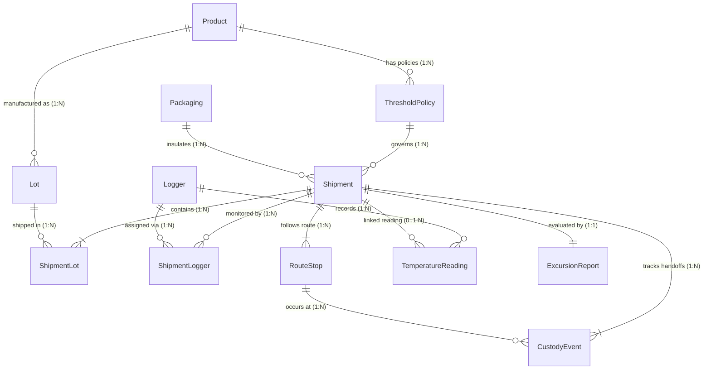

# Data Dictionary & Relational Schema Specification

**Domain**: Cold-Chain Shipment Compliance & Temperature Excursion Management  
**Generator Seed Default**: `20261022`  
**Schema Version**: `1.0.0`

---

## 1. Overview & Entity Relationship Model

This document specifies the complete data dictionary, field-level rules, primary/foreign key definitions, cardinality, lifecycle states, and bridge tables for the Cold-Chain Shipment Compliance & Deviation Management platform.

### Entity Relationship Diagram (Mermaid)

### Cardinality & Relationship Summary

| Parent Entity | Child / Bridge Entity | Cardinality | Foreign Key | Optionality | Description |
| :--- | :--- | :--- | :--- | :--- | :--- |
| `Product` | `ThresholdPolicy` | `1:N` | `ThresholdPolicy.product_id -> Product.product_id` | Mandatory parent | Each product has 1 or more versioned threshold policies over time; active policy selected by effective date. |
| `Product` | `Lot` | `1:N` | `Lot.product_id -> Product.product_id` | Mandatory parent | Every manufacturing lot belongs to exactly one product. |
| `Shipment` / `Lot` | `ShipmentLot` (Bridge) | `N:M` | `shipment_id`, `lot_id` | Mandatory parents | Many-to-many relationship between Shipments and Lots with shipped quantities. |
| `Packaging` | `Shipment` | `1:N` | `Shipment.packaging_id -> Packaging.packaging_id` | Mandatory parent | Each shipment uses one validated thermal packaging profile. |
| `ThresholdPolicy` | `Shipment` | `1:N` | `Shipment.assigned_policy_id -> ThresholdPolicy.policy_id` | Mandatory parent | Policy bound to shipment at creation. *(Edge case `THRESHOLD_MISMATCH` tests wrong policy binding).* |
| `Shipment` / `Logger` | `ShipmentLogger` (Bridge) | `N:M` | `shipment_id`, `logger_id` | Mandatory parents | Assigns 1 or more calibrated loggers to a shipment across time windows (supports logger reuse across non-overlapping shipments). |
| `Shipment` | `RouteStop` | `1:N` | `RouteStop.shipment_id -> Shipment.shipment_id` | Mandatory parent | Ordered sequence of origin, transit hubs, customs, and destination stops. |
| `Shipment` | `CustodyEvent` | `1:N` | `CustodyEvent.shipment_id -> Shipment.shipment_id` | Mandatory parent | Immutable log of custody handoffs and verifications along the route. |
| `RouteStop` | `CustodyEvent` | `1:N` | `CustodyEvent.stop_id -> RouteStop.stop_id` | Mandatory parent | Links each custody handoff event to the physical route stop. |
| `Logger` | `TemperatureReading` | `1:N` | `TemperatureReading.logger_id -> Logger.logger_id` | Mandatory parent | Timestamped telemetry recorded by a physical logger. |
| `Shipment` | `TemperatureReading` | `0..1:N` | `TemperatureReading.shipment_id -> Shipment.shipment_id` | Optional (`NULL` allowed) | Links reading to active shipment. Optional to represent `UNASSIGNED_LOGGER` orphan telemetry. |
| `Shipment` | `ExcursionReport` | `1:1` | `ExcursionReport.shipment_id -> Shipment.shipment_id` | Mandatory parent | Final compliance and deviation evaluation report per shipment. |
| `Shipment` | `ShipmentStateHistory` | `1:N` | `ShipmentStateHistory.shipment_id -> Shipment.shipment_id` | Mandatory parent | Immutable event history of shipment lifecycle transitions (persisting state changes without overwriting history). |

---

## 2. Granular Entity Specifications

### 2.1 `Product` (Master Table)
Represents a temperature-sensitive pharmaceutical, biologic, or clinical supply product.

| Field Name | Type | Required | Allowed Values / Format | Units | Uniqueness | Validation Rule |
| :--- | :--- | :--- | :--- | :--- | :--- | :--- |
| `product_id` | `STRING` | Required | `PROD-2026-\d{4}` | N/A | Primary Key (Unique) | Matches regex `^PROD-2026-\d{4}$` |
| `sku` | `STRING` | Required | Alphanumeric SKU code | N/A | Unique | Non-empty string, length 6–20 |
| `name` | `STRING` | Required | Free text product title | N/A | Unique | Non-empty string |
| `category` | `ENUM` | Required | `BIOLOGIC`, `VACCINE`, `MRNA_THERAPY`, `BLOOD_PLASMA`, `MONOCLONAL_ANTIBODY`, `INSULIN_PEPTIDE` | N/A | Non-unique | Must be in allowed enum list |
| `storage_regime` | `ENUM` | Required | `ULT_DEEP_FREEZE` (-80 to -60°C), `FROZEN` (-25 to -15°C), `REFRIGERATED` (2 to 8°C), `CONTROLLED_ROOM_TEMP` (15 to 25°C) | N/A | Non-unique | Must align with product's canonical `ThresholdPolicy` |
| `target_temp_c` | `FLOAT` | Required | `-80.0` to `25.0` | `°C` | Non-unique | Must lie strictly between canonical `min_temp_c` and `max_temp_c` |
| `unit_value_usd` | `FLOAT` | Required | `> 0.0` | `USD` | Non-unique | `unit_value_usd > 0` |
| `humidity_sensitive` | `BOOLEAN` | Required | `true`, `false` | N/A | Non-unique | Boolean check |
| `lifecycle_state` | `ENUM` | Required | `ACTIVE`, `PHASE_OUT`, `DISCONTINUED` | N/A | Non-unique | Valid lifecycle enum |
| `effective_from` | `ISO_DATETIME` | Required | ISO-8601 UTC (`YYYY-MM-DDTHH:MM:SSZ`) | `UTC` | Non-unique | `effective_from < effective_to` (if `effective_to` present) |
| `effective_to` | `ISO_DATETIME` | Optional | ISO-8601 UTC or `NULL` | `UTC` | Non-unique | `NULL` if `ACTIVE`, else `> effective_from` |

---

### 2.2 `ThresholdPolicy` (Master / Policy Table)
Defines product-specific temperature thresholds, cumulative/single excursion tolerances, MKT limits, and telemetry gap tolerances.

| Field Name | Type | Required | Allowed Values / Format | Units | Uniqueness | Validation Rule |
| :--- | :--- | :--- | :--- | :--- | :--- | :--- |
| `policy_id` | `STRING` | Required | `POL-2026-\d{4}` | N/A | Primary Key (Unique) | Matches regex `^POL-2026-\d{4}$` |
| `product_id` | `STRING` | Required | `PROD-2026-\d{4}` | N/A | Foreign Key | Must exist in `Product.product_id` |
| `version` | `INTEGER` | Required | `1, 2, ...` | N/A | Composite Unique `(product_id, version)` | `version >= 1` |
| `min_temp_c` | `FLOAT` | Required | `-90.0` to `20.0` | `°C` | Non-unique | `min_temp_c < max_temp_c` |
| `max_temp_c` | `FLOAT` | Required | `-55.0` to `30.0` | `°C` | Non-unique | `max_temp_c > min_temp_c` |
| `critical_low_temp_c` | `FLOAT` | Required | `< min_temp_c` | `°C` | Non-unique | `critical_low_temp_c <= min_temp_c - 1.0` (instant critical breach threshold) |
| `critical_high_temp_c` | `FLOAT` | Required | `> max_temp_c` | `°C` | Non-unique | `critical_high_temp_c >= max_temp_c + 2.0` (instant critical breach threshold) |
| `max_single_excursion_min` | `INTEGER` | Required | `10` to `240` | `minutes` | Non-unique | `max_single_excursion_min > 0` and `<= max_cumulative_excursion_min` |
| `max_cumulative_excursion_min` | `INTEGER` | Required | `20` to `480` | `minutes` | Non-unique | `>= max_single_excursion_min` |
| `max_mkt_c` | `FLOAT` | Required | `-55.0` to `28.0` | `°C` | Non-unique | `max_mkt_c >= max_temp_c` |
| `max_telemetry_gap_min` | `INTEGER` | Required | `20` to `60` | `minutes` | Non-unique | `>= 20` (missing-data interval `>= max_telemetry_gap_min` is flagged) |
| `max_custody_gap_min` | `INTEGER` | Required | `60` to `240` | `minutes` | Non-unique | `> 0` (configurable custody handover delay limit, default `120` min) |
| `effective_from` | `ISO_DATETIME` | Required | ISO-8601 UTC | `UTC` | Non-unique | Valid ISO timestamp |
| `effective_to` | `ISO_DATETIME` | Optional | ISO-8601 UTC or `NULL` | `UTC` | Non-unique | `NULL` or `> effective_from` |
| `lifecycle_state` | `ENUM` | Required | `ACTIVE`, `SUPERSEDED`, `RETIRED` | N/A | Non-unique | Valid enum |

---

### 2.3 `Lot` (Master Table)
Represents a specific manufacturing batch of a `Product` with expiration dates and initial stability budget.

| Field Name | Type | Required | Allowed Values / Format | Units | Uniqueness | Validation Rule |
| :--- | :--- | :--- | :--- | :--- | :--- | :--- |
| `lot_id` | `STRING` | Required | `LOT-2026-\d{6}` | N/A | Primary Key (Unique) | Matches regex `^LOT-2026-\d{6}$` |
| `product_id` | `STRING` | Required | `PROD-2026-\d{4}` | N/A | Foreign Key | Must exist in `Product.product_id` |
| `manufacturing_site` | `STRING` | Required | Facility code (e.g., `BASEL-CH-01`, `BOSTON-US-02`) | N/A | Non-unique | Non-empty string |
| `manufactured_date` | `ISO_DATE` | Required | `YYYY-MM-DD` | `Date` | Non-unique | `manufactured_date < expiry_date` |
| `expiry_date` | `ISO_DATE` | Required | `YYYY-MM-DD` | `Date` | Non-unique | `expiry_date > manufactured_date` |
| `initial_quantity_units` | `INTEGER` | Required | `100` to `50000` | `vials/units` | Non-unique | `> 0` |
| `remaining_stability_budget_min` | `INTEGER` | Required | `0` to `480` | `minutes` | Non-unique | `>= 0` |
| `lifecycle_state` | `ENUM` | Required | `RELEASED`, `QUARANTINED`, `RECALLED`, `DEPLETED` | N/A | Non-unique | Valid enum |

---

### 2.4 `Packaging` (Master Table)
Defines thermal container types, cooling media, and validated autonomous hold time.

| Field Name | Type | Required | Allowed Values / Format | Units | Uniqueness | Validation Rule |
| :--- | :--- | :--- | :--- | :--- | :--- | :--- |
| `packaging_id` | `STRING` | Required | `PKG-2026-\d{4}` | N/A | Primary Key (Unique) | Matches regex `^PKG-2026-\d{4}$` |
| `model_name` | `STRING` | Required | Free text model name | N/A | Unique | Non-empty string |
| `packaging_type` | `ENUM` | Required | `ACTIVE_ULD_COMPRESSOR`, `DRY_ICE_SHIPPER`, `PASSIVE_PCM_VIP`, `GEL_PACK_INSULATED` | N/A | Non-unique | Valid enum |
| `target_regime` | `ENUM` | Required | `ULT_DEEP_FREEZE`, `FROZEN`, `REFRIGERATED`, `CONTROLLED_ROOM_TEMP` | N/A | Non-unique | Valid regime enum |
| `validated_hold_hours` | `INTEGER` | Required | `36` to `168` | `hours` | Non-unique | `>= 24` |
| `insulation_r_value` | `FLOAT` | Required | `5.0` to `45.0` | `m²·K/W` | Non-unique | `> 0.0` |
| `payload_capacity_liters` | `FLOAT` | Required | `10.0` to `1500.0` | `liters` | Non-unique | `> 0.0` |
| `reusable` | `BOOLEAN` | Required | `true`, `false` | N/A | Non-unique | Boolean |
| `lifecycle_state` | `ENUM` | Required | `QUALIFIED`, `MAINTENANCE`, `RETIRED` | N/A | Non-unique | Valid enum |

---

### 2.5 `Logger` (Master Table)
Represents physical IoT / electronic temperature data loggers with NIST-traceable calibration attributes.

| Field Name | Type | Required | Allowed Values / Format | Units | Uniqueness | Validation Rule |
| :--- | :--- | :--- | :--- | :--- | :--- | :--- |
| `logger_id` | `STRING` | Required | `LOG-SHP-2026-\d{6}-\d{2}` | N/A | Primary Key (Unique) | Matches nomenclature `LOG-<shipment-id>-01` (first-assigned canonical ID) |
| `serial_number` | `STRING` | Required | `SN-YF-\d{8}` | N/A | Unique | Matches regex `^SN-YF-\d{8}$` |
| `manufacturer_model` | `ENUM` | Required | `Sensitech-TempTale-Geo-Ultra`, `ELPRO-LIBERO-GE`, `Berlinger-Q-tag-CLm`, `Testo-184-T4` | N/A | Non-unique | Valid enum |
| `sampling_interval_min` | `INTEGER` | Required | `10` | `minutes` | Non-unique | Must equal `10` |
| `calibration_uncertainty_c` | `FLOAT` | Required | `0.10` to `0.60` | `±°C` | Non-unique | `0.05 <= calibration_uncertainty_c <= 1.0` |
| `calibration_date` | `ISO_DATE` | Required | `YYYY-MM-DD` | `Date` | Non-unique | `< calibration_expiry_date` |
| `calibration_expiry_date` | `ISO_DATE` | Required | `YYYY-MM-DD` | `Date` | Non-unique | `> calibration_date` |
| `battery_pct` | `INTEGER` | Required | `15` to `100` | `%` | Non-unique | `0 <= battery_pct <= 100` |
| `firmware_version` | `STRING` | Required | `v\d+\.\d+\.\d+` | N/A | Non-unique | Non-empty string |
| `lifecycle_state` | `ENUM` | Required | `ACTIVE_CALIBRATED`, `CALIBRATION_DUE`, `DECOMMISSIONED` | N/A | Non-unique | Valid enum |

---

### 2.6 `Shipment` (Core Transaction Table)
Represents a temperature-sensitive freight movement from supplier origin to destination warehouse/clinic.

| Field Name | Type | Required | Allowed Values / Format | Units | Uniqueness | Validation Rule |
| :--- | :--- | :--- | :--- | :--- | :--- | :--- |
| `shipment_id` | `STRING` | Required | `SHP-2026-\d{6}` | N/A | Primary Key (Unique) | Matches regex `^SHP-2026-\d{6}$` |
| `primary_product_id` | `STRING` | Required | `PROD-2026-\d{4}` | N/A | Foreign Key | Must exist in `Product.product_id` |
| `assigned_policy_id` | `STRING` | Required | `POL-2026-\d{4}` | N/A | Foreign Key | Must exist in `ThresholdPolicy.policy_id` |
| `packaging_id` | `STRING` | Required | `PKG-2026-\d{4}` | N/A | Foreign Key | Must exist in `Packaging.packaging_id` |
| `supplier_actor` | `STRING` | Required | Supplier organization ID/name | N/A | Non-unique | Non-empty string |
| `planner_actor` | `STRING` | Required | Logistics planner ID | N/A | Non-unique | Non-empty string |
| `carrier_actor` | `STRING` | Required | Carrier organization name | N/A | Non-unique | Non-empty string |
| `origin_location` | `STRING` | Required | UN/LOCODE or airport hub | N/A | Non-unique | `origin_location != destination_location` |
| `destination_location` | `STRING` | Required | UN/LOCODE or facility hub | N/A | Non-unique | `destination_location != origin_location` |
| `transport_mode` | `ENUM` | Required | `AIR_FREIGHT`, `OCEAN_REEFER`, `ROAD_REEFER`, `MULTIMODAL_AIR_ROAD` | N/A | Non-unique | Valid enum |
| `planned_departure_utc` | `ISO_DATETIME` | Required | ISO-8601 UTC | `UTC` | Non-unique | `< planned_arrival_utc` |
| `planned_arrival_utc` | `ISO_DATETIME` | Required | ISO-8601 UTC | `UTC` | Non-unique | `> planned_departure_utc` |
| `actual_departure_utc` | `ISO_DATETIME` | Required | ISO-8601 UTC | `UTC` | Non-unique | `< actual_arrival_utc` |
| `actual_arrival_utc` | `ISO_DATETIME` | Required | ISO-8601 UTC | `UTC` | Non-unique | `> actual_departure_utc` |
| `total_distance_km` | `FLOAT` | Required | `150.0` to `14500.0` | `km` | Non-unique | `> 0.0` |
| `declared_value_usd` | `FLOAT` | Required | `> 0.0` | `USD` | Non-unique | Reconciles with `SUM(ShipmentLot.quantity_units * Product.unit_value_usd)` |
| `lifecycle_state` | `ENUM` | Required | `PLANNED`, `PACKED`, `IN_TRANSIT`, `DELIVERED`, `EVALUATED`, `CLOSED_RELEASED`, `CLOSED_QUARANTINED`, `CLOSED_REJECTED` | N/A | Non-unique | Valid lifecycle state |

---

### 2.7 `ShipmentLot` (Bridge Table: Shipment <-> Lot, N:M)
Links shipments to one or more manufacturing lots and tracks quantity per lot.

| Field Name | Type | Required | Allowed Values / Format | Units | Uniqueness | Validation Rule |
| :--- | :--- | :--- | :--- | :--- | :--- | :--- |
| `shipment_lot_id` | `STRING` | Required | `SHPLOT-2026-\d{6}` | N/A | Primary Key (Unique) | Matches regex `^SHPLOT-2026-\d{6}$` |
| `shipment_id` | `STRING` | Required | `SHP-2026-\d{6}` | N/A | Foreign Key | Must exist in `Shipment.shipment_id` |
| `lot_id` | `STRING` | Required | `LOT-2026-\d{6}` | N/A | Foreign Key | Must exist in `Lot.lot_id` |
| `quantity_units` | `INTEGER` | Required | `10` to `5000` | `units` | Composite Unique `(shipment_id, lot_id)` | `> 0` and `<= Lot.initial_quantity_units` |

---

### 2.8 `ShipmentLogger` (Bridge Table: Shipment <-> Logger, N:M)
Binds physical loggers to shipments over explicit activation/deactivation windows.

| Field Name | Type | Required | Allowed Values / Format | Units | Uniqueness | Validation Rule |
| :--- | :--- | :--- | :--- | :--- | :--- | :--- |
| `assignment_id` | `STRING` | Required | `ASSGN-2026-\d{6}` | N/A | Primary Key (Unique) | Matches regex `^ASSGN-2026-\d{6}$` |
| `shipment_id` | `STRING` | Required | `SHP-2026-\d{6}` | N/A | Foreign Key | Must exist in `Shipment.shipment_id` |
| `logger_id` | `STRING` | Required | `LOG-SHP-2026-\d{6}-\d{2}` | N/A | Foreign Key | Must exist in `Logger.logger_id` |
| `sensor_position` | `ENUM` | Required | `PAYLOAD_CORE`, `PAYLOAD_TOP_CORNER`, `EXTERNAL_AMBIENT` | N/A | Composite Unique `(shipment_id, logger_id)` | Valid enum |
| `activated_utc` | `ISO_DATETIME` | Required | ISO-8601 UTC | `UTC` | Non-unique | `<= Shipment.actual_departure_utc` |
| `deactivated_utc` | `ISO_DATETIME` | Required | ISO-8601 UTC | `UTC` | Non-unique | `>= Shipment.actual_arrival_utc` |
| `assignment_status` | `ENUM` | Required | `BOUND_ACTIVE`, `COMPLETED`, `UNASSIGNED_ERROR` | N/A | Non-unique | Valid enum |

---

### 2.9 `RouteStop` (Child Event Table)
Captures ordered waypoints, transit hubs, customs inspections, and dwell intervals for a shipment.

| Field Name | Type | Required | Allowed Values / Format | Units | Uniqueness | Validation Rule |
| :--- | :--- | :--- | :--- | :--- | :--- | :--- |
| `stop_id` | `STRING` | Required | `STOP-SHP-2026-\d{6}-\d{2}` | N/A | Primary Key (Unique) | Matches regex `^STOP-SHP-2026-\d{6}-\d{2}$` |
| `shipment_id` | `STRING` | Required | `SHP-2026-\d{6}` | N/A | Foreign Key | Must exist in `Shipment.shipment_id` |
| `sequence_no` | `INTEGER` | Required | `1, 2, ...` | N/A | Composite Unique `(shipment_id, sequence_no)` | Sequential starting at `1` |
| `location_code` | `STRING` | Required | Hub / facility identifier | N/A | Non-unique | Non-empty string |
| `stop_type` | `ENUM` | Required | `ORIGIN_WAREHOUSE`, `AIRPORT_TARMAC`, `CUSTOMS_BORDER`, `CROSS_DOCK_HUB`, `DESTINATION_FACILITY` | N/A | Non-unique | Valid enum |
| `ambient_temp_c` | `FLOAT` | Required | `-15.0` to `42.0` | `°C` | Non-unique | Realistic environmental ambient temperature |
| `has_cold_storage` | `BOOLEAN` | Required | `true`, `false` | N/A | Non-unique | Boolean |
| `planned_arrival_utc` | `ISO_DATETIME` | Required | ISO-8601 UTC | `UTC` | Non-unique | `<= planned_departure_utc` |
| `planned_departure_utc` | `ISO_DATETIME` | Required | ISO-8601 UTC | `UTC` | Non-unique | `>= planned_arrival_utc` |
| `actual_arrival_utc` | `ISO_DATETIME` | Required | ISO-8601 UTC | `UTC` | Non-unique | `<= actual_departure_utc` |
| `actual_departure_utc` | `ISO_DATETIME` | Required | ISO-8601 UTC | `UTC` | Non-unique | `>= actual_arrival_utc` |
| `dwell_duration_min` | `INTEGER` | Required | `>= 0` | `minutes` | Non-unique | Must equal `(actual_departure_utc - actual_arrival_utc)` in minutes |
| `dwell_event_flag` | `ENUM` | Required | `NORMAL_STOP`, `EXTENDED_TARMAC_DWELL`, `CUSTOMS_HOLD_DELAY`, `REEFER_POWER_OUTAGE` | N/A | Non-unique | Valid enum |

---

### 2.10 `CustodyEvent` (Child Event Table)
Immutable chain-of-custody handoff records between actors at route stops.

| Field Name | Type | Required | Allowed Values / Format | Units | Uniqueness | Validation Rule |
| :--- | :--- | :--- | :--- | :--- | :--- | :--- |
| `custody_event_id` | `STRING` | Required | `CUST-2026-\d{7}` | N/A | Primary Key (Unique) | Matches regex `^CUST-2026-\d{7}$` |
| `shipment_id` | `STRING` | Required | `SHP-2026-\d{6}` | N/A | Foreign Key | Must exist in `Shipment.shipment_id` |
| `stop_id` | `STRING` | Required | `STOP-SHP-2026-\d{6}-\d{2}` | N/A | Foreign Key | Must exist in `RouteStop.stop_id` |
| `sequence_no` | `INTEGER` | Required | `1, 2, ...` | N/A | Composite Unique `(shipment_id, sequence_no)` | Sequential per shipment |
| `event_type` | `ENUM` | Required | `PACKOUT_SEALED`, `CARRIER_PICKUP`, `HUB_ARRIVAL_SCAN`, `CUSTOMS_INSPECTION`, `HUB_DEPARTURE_SCAN`, `FINAL_RECEIPT`, `QUARANTINE_HOLD` | N/A | Non-unique | Valid enum |
| `from_actor_role` | `ENUM` | Required | `SUPPLIER`, `PLANNER`, `CARRIER_OPERATOR`, `WAREHOUSE_OPERATOR`, `CUSTOMS_OFFICER`, `LOGISTICS_ANALYST`, `OPERATIONS_MANAGER` | N/A | Non-unique | Valid actor role |
| `to_actor_role` | `ENUM` | Required | `SUPPLIER`, `PLANNER`, `CARRIER_OPERATOR`, `WAREHOUSE_OPERATOR`, `CUSTOMS_OFFICER`, `LOGISTICS_ANALYST`, `OPERATIONS_MANAGER` | N/A | Non-unique | Valid actor role |
| `event_timestamp_utc` | `ISO_DATETIME` | Required | ISO-8601 UTC | `UTC` | Non-unique | Monotonically non-decreasing per shipment |
| `handover_gap_min` | `INTEGER` | Required | `>= 0` | `minutes` | Non-unique | Derived difference from previous custody timestamp or stop arrival |
| `custody_gap_flagged` | `BOOLEAN` | Required | `true`, `false` | N/A | Non-unique | `true` if `handover_gap_min > 120` (unless `CUSTODY_GAP_UNFLAGGED` edge case) |
| `seal_intact` | `BOOLEAN` | Required | `true`, `false` | N/A | Non-unique | Boolean |
| `operator_signature_hash` | `STRING` | Required | 16-char hex digest | N/A | Non-unique | Deterministic SHA-256 prefix of event payload |

---

### 2.11 `TemperatureReading` (High-Volume Telemetry Event Table)
Timestamped 10-minute temperature readings generated by loggers.

| Field Name | Type | Required | Allowed Values / Format | Units | Uniqueness | Validation Rule |
| :--- | :--- | :--- | :--- | :--- | :--- | :--- |
| `reading_id` | `STRING` | Required | `TEMP-<logger-id>-<YYYYMMDDHHMMSS>` | N/A | Primary Key (Unique) | Matches `^TEMP-LOG-SHP-2026-\d{6}-\d{2}-\d{14}$` |
| `logger_id` | `STRING` | Required | `LOG-SHP-2026-\d{6}-\d{2}` | N/A | Foreign Key | Must exist in `Logger.logger_id` |
| `shipment_id` | `STRING` | Optional | `SHP-2026-\d{6}` or `NULL` | N/A | Foreign Key | Must exist in `Shipment.shipment_id` if non-null |
| `sequence_no` | `INTEGER` | Required | `1, 2, ...` | N/A | Composite Unique `(logger_id, recorded_at_utc)` | Positive integer |
| `recorded_at_utc` | `ISO_DATETIME` | Required | ISO-8601 UTC | `UTC` | Non-unique | Strictly ordered by `sequence_no` per trip |
| `temperature_c` | `FLOAT` | Required | `-95.0` to `50.0` | `°C` | Non-unique | Rounded to 2 decimal places |
| `ambient_estimate_c` | `FLOAT` | Required | `-25.0` to `45.0` | `°C` | Non-unique | Rounded to 2 decimal places |
| `calibration_uncertainty_c` | `FLOAT` | Required | `0.10` to `0.60` | `±°C` | Non-unique | Matches `Logger.calibration_uncertainty_c` |
| `elapsed_since_prev_min` | `INTEGER` | Required | `0` (first reading) or `>= 10` | `minutes` | Non-unique | Exact difference `(recorded_at_utc - prev_recorded_at_utc)` in minutes |
| `is_excursion_point` | `BOOLEAN` | Required | `true`, `false` | N/A | Non-unique | `true` if `temperature_c` (or uncertainty band) violates policy bounds |
| `sensor_status` | `ENUM` | Required | `OK`, `GAP_RECOVERED`, `LOW_BATTERY_WARN`, `CALIBRATION_DRIFT_WARN` | N/A | Non-unique | Valid enum |

---

### 2.12 `ExcursionReport` (Compliance & Evaluation Outcome Table)
Traces each shipment's final compliance conclusion to its temperature readings, custody events, and threshold policy.

| Field Name | Type | Required | Allowed Values / Format | Units | Uniqueness | Validation Rule |
| :--- | :--- | :--- | :--- | :--- | :--- | :--- |
| `report_id` | `STRING` | Required | `EXCR-2026-\d{6}` | N/A | Primary Key (Unique) | Matches regex `^EXCR-2026-\d{6}$` |
| `shipment_id` | `STRING` | Required | `SHP-2026-\d{6}` | N/A | Foreign Key (Unique 1:1) | Must exist in `Shipment.shipment_id` |
| `policy_id_evaluated` | `STRING` | Required | `POL-2026-\d{4}` | N/A | Foreign Key | Must exist in `ThresholdPolicy.policy_id` |
| `logger_id_evaluated` | `STRING` | Optional | `LOG-SHP-2026-\d{6}-\d{2}` or `NULL` | N/A | Foreign Key | Must exist in `Logger.logger_id` if non-null |
| `expected_reading_count` | `INTEGER` | Required | `>= 1` | `count` | Non-unique | `((actual_arrival - actual_departure) / 10 min) + 1` |
| `actual_reading_count` | `INTEGER` | Required | `>= 0` | `count` | Non-unique | Count of `TemperatureReading` rows evaluated |
| `missing_reading_count` | `INTEGER` | Required | `>= 0` | `count` | Non-unique | `expected_reading_count - actual_reading_count` |
| `max_telemetry_gap_min` | `INTEGER` | Required | `>= 0` | `minutes` | Non-unique | Max `elapsed_since_prev_min - 10` across trip readings |
| `telemetry_gap_flagged` | `BOOLEAN` | Required | `true`, `false` | N/A | Non-unique | `true` if `max_telemetry_gap_min > policy.max_telemetry_gap_min` |
| `custody_gap_flagged` | `BOOLEAN` | Required | `true`, `false` | N/A | Non-unique | `true` if any `CustodyEvent` has `custody_gap_flagged == true` |
| `min_recorded_temp_c` | `FLOAT` | Optional | `-95.0` to `50.0` or `NULL` | `°C` | Non-unique | `MIN(temperature_c)` from readings |
| `max_recorded_temp_c` | `FLOAT` | Optional | `-95.0` to `50.0` or `NULL` | `°C` | Non-unique | `MAX(temperature_c)` from readings |
| `mean_kinetic_temp_c` | `FLOAT` | Optional | `-95.0` to `50.0` or `NULL` | `°C` | Non-unique | Derived via Haynes MKT formula from readings |
| `total_excursion_duration_min` | `INTEGER` | Required | `>= 0` | `minutes` | Non-unique | Cumulative minutes outside `[min_temp_c, max_temp_c]` |
| `max_single_excursion_min` | `INTEGER` | Required | `>= 0` | `minutes` | Non-unique | Longest contiguous excursion window in minutes |
| `uncertainty_borderline_flag` | `BOOLEAN` | Required | `true`, `false` | N/A | Non-unique | `true` if reading is within `[min_temp_c - unc, min_temp_c + unc]` or `[max_temp_c - unc, max_temp_c + unc]` |
| `compliance_status` | `ENUM` | Required | `COMPLIANT`, `MINOR_EXCURSION_ACCEPTABLE`, `CRITICAL_EXCURSION`, `NON_COMPLIANT_MISSING_DATA`, `NON_COMPLIANT_CUSTODY_GAP`, `INVESTIGATION_REQUIRED` | N/A | Non-unique | Derived from documented rules |
| `disposition_decision` | `ENUM` | Required | `AUTO_RELEASE`, `RELEASE_WITH_STABILITY_DEDUCTION`, `QA_MANUAL_REVIEW`, `QUARANTINE_HOLD`, `REJECT_DESTROY` | N/A | Non-unique | Derived from `compliance_status` |
| `first_breach_reading_id` | `STRING` | Optional | `TEMP-...` or `NULL` | N/A | Foreign Key | Points to exact first breaching `TemperatureReading.reading_id` |
| `evaluated_by_actor` | `ENUM` | Required | `LOGISTICS_ANALYST`, `OPERATIONS_MANAGER`, `AUTOMATED_POLICY_ENGINE` | N/A | Non-unique | Valid actor enum |
| `evaluated_at_utc` | `ISO_DATETIME` | Required | ISO-8601 UTC | `UTC` | Non-unique | `>= Shipment.actual_arrival_utc` |

---

### 2.13 `ShipmentStateHistory` (Audit / Event History Table)
Explicitly persists every state transition of a `Shipment` so history is never overwritten (Rule 4).

| Field Name | Type | Required | Allowed Values / Format | Units | Uniqueness | Validation Rule |
| :--- | :--- | :--- | :--- | :--- | :--- | :--- |
| `state_event_id` | `STRING` | Required | `STHIST-2026-\d{7}` | N/A | Primary Key (Unique) | Matches regex `^STHIST-2026-\d{7}$` |
| `shipment_id` | `STRING` | Required | `SHP-2026-\d{6}` | N/A | Foreign Key | Must exist in `Shipment.shipment_id` |
| `sequence_no` | `INTEGER` | Required | `1, 2, ...` | N/A | Composite Unique `(shipment_id, sequence_no)` | Sequential starting at 1 |
| `prior_state` | `ENUM` | Optional | `NULL` (initial) or valid state | N/A | Non-unique | Matches previous transition's `new_state` |
| `new_state` | `ENUM` | Required | `PLANNED`, `PACKED`, `IN_TRANSIT`, `DELIVERED`, `EVALUATED`, `CLOSED_RELEASED`, `CLOSED_QUARANTINED`, `CLOSED_REJECTED` | N/A | Non-unique | Must follow legal state transition DAG |
| `changed_at_utc` | `ISO_DATETIME` | Required | ISO-8601 UTC | `UTC` | Non-unique | Strictly non-decreasing per shipment |
| `actor_role` | `ENUM` | Required | `PLANNER`, `SUPPLIER`, `CARRIER_OPERATOR`, `WAREHOUSE_OPERATOR`, `LOGISTICS_ANALYST`, `OPERATIONS_MANAGER` | N/A | Non-unique | Valid role |
| `reason_code` | `STRING` | Required | Structured reason code | N/A | Non-unique | Non-empty string |

---

## 3. Ground Truth & Anomaly Labels (`ground_truth.csv` / `ground_truth.json`)

Kept strictly separate from input entity tables so evaluation features are never leaked.

| Field Name | Type | Description |
| :--- | :--- | :--- |
| `shipment_id` | `STRING` | Primary key linking to `Shipment.shipment_id` |
| `scenario_category` | `ENUM` | `NORMAL_COMPLIANT`, `MINOR_EXCURSION`, `CRITICAL_EXCURSION`, `CALIBRATION_BORDERLINE`, `TELEMETRY_GAP_FLAGGED`, `ROUTE_DWELL_EXCURSION`, `EDGE_LOGGER_NOT_ASSIGNED`, `EDGE_PRODUCT_THRESHOLD_MISMATCH`, `EDGE_MISSING_DATA_SILENTLY_PASSED`, `EDGE_CUSTODY_GAP_NOT_FLAGGED`, `EDGE_CROSS_SHIPMENT_EXCURSION_CALC` |
| `is_injected_edge_case` | `BOOLEAN` | `true` if one of the 5 negative system/process defect scenarios, `false` otherwise |
| `edge_case_type` | `ENUM` | `NONE`, `LOGGER_NOT_ASSIGNED`, `PRODUCT_THRESHOLD_MISMATCH`, `MISSING_DATA_SILENTLY_PASSED`, `CUSTODY_GAP_NOT_FLAGGED`, `CROSS_SHIPMENT_EXCURSION_CALC` |
| `true_policy_id` | `STRING` | Canonical `ThresholdPolicy.policy_id` required by `Shipment.primary_product_id` |
| `true_excursion_duration_min` | `INTEGER` | True cumulative excursion duration computed strictly against `true_policy_id` and single-shipment readings |
| `true_max_single_excursion_min` | `INTEGER` | True longest single excursion window |
| `true_telemetry_gap_min` | `INTEGER` | True maximum telemetry gap in minutes |
| `true_custody_gap_min` | `INTEGER` | True maximum custody handover gap in minutes |
| `true_compliance_status` | `ENUM` | Ground-truth compliance status when all business rules are properly enforced |
| `true_disposition_decision` | `ENUM` | Ground-truth disposition decision (`AUTO_RELEASE`, `RELEASE_WITH_STABILITY_DEDUCTION`, `QA_MANUAL_REVIEW`, `QUARANTINE_HOLD`, `REJECT_DESTROY`) |
| `reported_compliance_status` | `ENUM` | What was recorded in `ExcursionReport.compliance_status` (differs from `true_compliance_status` on injected negative edge cases) |
| `root_cause_summary` | `STRING` | Human-readable audit explanation of the true physical and procedural state |
